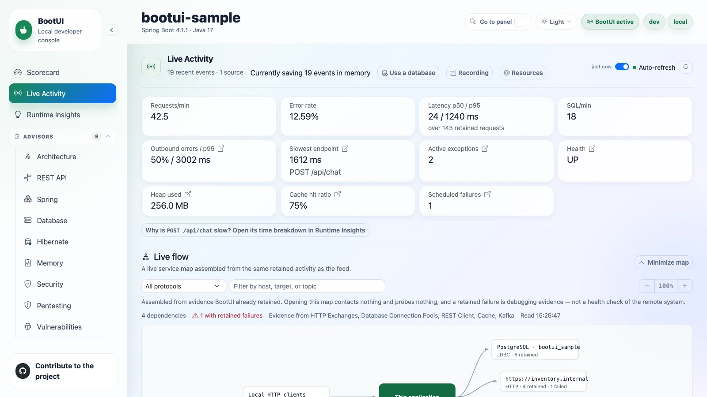
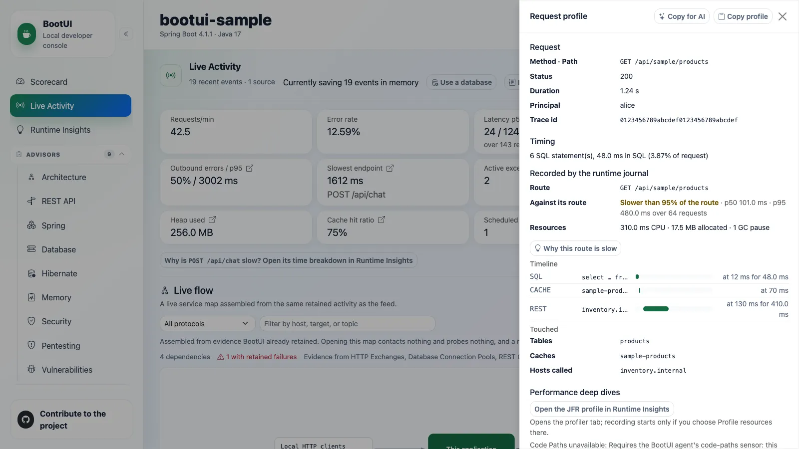

# Live Activity

The diagnostics home base: one reverse-chronological stream of everything the application just did, plus a per-request
profiler for drilling into any single request.

It reuses the existing panel buffers where it can and supplements them with runtime-journal events. Panel-backed values
remain masked, self-filtered, and bounded exactly as they are in their dedicated panels.

## Feed types

The type filter currently exposes these 17 kinds. Their availability depends on the application's stack, enabled
panels, and installed integrations.

| Signal             | Type              | Captured from                                           |
| ------------------ | ----------------- | ------------------------------------------------------- |
| Requests           | `REQUEST`         | HTTP Exchanges                                          |
| SQL                | `SQL`             | SQL Trace                                               |
| Exceptions         | `EXCEPTION`       | Exceptions                                              |
| Security           | `SECURITY`        | Security Logs                                           |
| Cache              | `CACHE`           | Cache activity                                          |
| Scheduled          | `SCHEDULED`       | Scheduled-task execution                                |
| Messaging          | `MESSAGING`       | Kafka, RabbitMQ, or JMS activity                        |
| Emails             | `MAIL`            | Email activity                                          |
| REST client        | `REST_CLIENT`     | REST Client                                             |
| Fault tolerance    | `FAULT_TOLERANCE` | Resilience4j, Spring Retry, or SmallRye Fault Tolerance |
| Transactions       | `TRANSACTION`     | Transaction activity                                    |
| AI                 | `AI`              | AI Framework activity                                   |
| Logs               | `LOG`             | Log Tail                                                |
| Application events | `APP_EVENT`       | Application event publication and listeners             |
| WebSockets         | `WEBSOCKET`       | Inbound WebSocket handlers                              |
| ORM                | `ORM`             | Hibernate sessions                                      |
| Async handoffs     | `ASYNC`           | BootUI agent executor propagation                       |

Scheduled-task capture records each `@Scheduled` method _execution_ — start, success, failure, duration — without extra
proxying on either adapter. Each run also gets its own BootUI execution id while it runs, so the SQL statements,
exceptions, and REST client calls it makes nest under the run, even on another thread. On Quarkus this covers blocking
`@Scheduled` methods; one returning a `Uni` or `CompletionStage` completes later and its run carries no execution id. Cache rows summarize the operation and cache name (`MISS orders`), with `WARN` severity for
a miss and `OK` otherwise; the detail shows only a short hashed key (`key a1b2c3…`), never a raw key or value, even
under full value exposure.

## Reading the feed

Each row carries a timestamp, a type icon, a severity (`OK`, `SLOW`, `WARN`, `ERROR`), a one-line summary, and a
duration. Failed rows are highlighted. Slow requests are tinted on a graduated yellow-to-red heat scale crossing 100,
200, 500, and 1000 ms, with a matching latency badge. A request whose correlated SQL looks like an N+1 access pattern
carries a red **N+1** badge in the row itself, computed from literal-free SQL shapes with the same threshold for live
and persisted rows when the same SQL events are available.

When the feed is unfiltered, signals BootUI can pin to a request are **nested chronologically beneath it** and expanded
by default, so one click shows exactly what a single request did, in order. Requests that triggered a security event are
flagged **authenticated** with a lock icon and the caller's principal. Signals that cannot be tied to a request stay
top-level, and any filter or search flattens the feed so the query spans every signal.

Adjacent identical entries collapse with an occurrence count. The feed filters by type, severity, free text (path,
status, SQL, or exception class), and an **errors-only** toggle; the chosen filters persist across reloads. A
requests-over-time sparkline above the table makes spikes and error bursts visible at a glance. With the runtime journal
as its source, dashed lines on it mark what can explain a change in traffic, each also listed as a **MARKER** row: a
change made from a BootUI panel (a logger level, a configuration override, a cache clear, a migration, **Clear
recording**, a heap dump), an availability change, a configuration refresh, or shutdown. A marker names what was
targeted, never a value. **APP_EVENT** rows list the application events a request published and each listener's run:
on Spring through BootUI's event multicaster, transactional listeners' deferral, effective execution phase, and skips
included. A listener running through `fallbackExecution` without an active transaction is `IMMEDIATE`, regardless of
its annotation's phase; a deferred callback retains its transaction phase, including a reactive transaction carried
in the event's source. When the application defines its own multicaster, as Spring Modulith's event publication
registry does, BootUI keeps it and records no application event. On Quarkus, listener runs are recorded through an
interceptor bound at build time to the application's `@Observes` and `@ObservesAsync` methods. Framework
events are left out, and an event's fields are never recorded. Change impact accepts an event type, such as
`OrderPlaced`, and lists the routes that published or consumed it. **ORM** rows give each Hibernate session's statements, flushes,
the auto-flushes that wrote before a query, and the most entities its persistence context held, under the request that
opened it; **WEBSOCKET** rows are inbound WebSocket messages, each an execution owning what its handler did. With the
[BootUI agent](java-agent.md) attached, **ASYNC** rows are the tasks a request handed to a JDK executor, nested under it:
the task's class, the hook that propagated it, its queue time, and its outcome, badged **after response** when it worked
once the response started (its body was still running, or, after a body that ended before, a dependent stage or
`done()` callback ran SQL, a REST call, or a message, failed, or ran 50 ms, after it; a task whose handler waited
for its result is not badged merely because its run closed just after the response), **running** while it still runs,
and **past deadline** when it ended more
than `bootui.agent.executors.max-handoff` after it started. The request's journal profile lists them under
**Handoffs**, each with its thread, duration, queue time, what it did (its SQL statements, REST calls, and messages),
its outcome, and its allocated bytes; a task that started more than `max-handoff` after the request ended is only
counted, and neither it nor its work is drawn on the timeline.

Because the feed is genuinely event-driven, it refreshes over **Server-Sent Events** rather than fixed-interval polling.
The browser subscribes to `/bootui/api/activity/stream` and re-fetches when any source signals a change. The feed can be
paused and resumed so a row you are inspecting does not scroll away.

Every row is a launchpad. Clicking a request row opens its profiler; every row deep-links to its dedicated panel with
the originating record pre-filtered. A buffer-backed `MAIL` row opens that message's detail drawer. A runtime-journal
`MAIL` row has no Email-panel message id, so it opens the Email panel without selecting a message.

::: details The KPI strip

Across the top: requests per minute, error rate, p50/p95 latency, SQL rate, the slowest recent endpoint, active
exception count, health status, heap usage, and scheduled-task failure count. On Spring servlet and WebFlux only,
outbound REST-call error rate and p95 latency, plus the cache hit ratio. All are computed from the same buffers, and
sub-millisecond SQL is shown as `<1 ms`.

The p50/p95 latency and the slowest request are computed once, in the shared engine, over every retained request with a
duration, so Spring MVC, Spring WebFlux, and Quarkus report the same figures for the same traffic; the latency card
states how many requests they cover. The slowest request is labelled with its resolved route, such as
`GET /api/orders/{id}`, and a tie goes to the newest request.

Several cards are launchpads: outbound-errors opens **REST Client**, slowest-endpoint opens that route's row in the
[HTTP Exchanges route rankings](diagnostics.md#route-rankings) with its exchanges listed, and the active-exceptions,
health, heap-usage, cache-hit-ratio, and scheduled-failures cards jump to **Exceptions**, **Health**, **Heap Dump**,
**Cache**, and **Scheduled Tasks**.

:::

## The per-request profiler

Clicking a request opens a Symfony-style drawer that correlates that request's SQL, exceptions, security events, REST
client calls, and cache accesses. It degrades gracefully and never fabricates data — every section is labelled with the
tier that correlated it, and the whole profile is marked approximate whenever a time-window match was used.

| Tier           | How it matches                                                                                                                                                                                                                                                                                                                                                               | Adapters            | Labelled        |
| -------------- | ---------------------------------------------------------------------------------------------------------------------------------------------------------------------------------------------------------------------------------------------------------------------------------------------------------------------------------------------------------------------------- | ------------------- | --------------- |
| Request id     | The BootUI request id stamped on the signal when it was recorded                                                                                                                                                                                                                                                                                                             | All                 | **exact**       |
| Propagated     | The request id, on work recorded in a task the [BootUI agent](java-agent.md) propagated from the request to a JDK executor, when the task started within `bootui.agent.executors.max-handoff` of the request's end and the work within `max-handoff` of the task's start; unavailable, with the reason, unless the agent's `executors` sensor propagates for the application | All, with the agent | **exact**       |
| Trace id       | A trace id that exactly one captured request carries                                                                                                                                                                                                                                                                                                                         | All                 | **exact**       |
| Serving thread | The one worker thread that served the request, inside its window                                                                                                                                                                                                                                                                                                             | Spring MVC          | **exact**       |
| Time window    | The request's time window — plus method and path for exceptions, and the principal for security events                                                                                                                                                                                                                                                                       | Spring MVC          | **approximate** |

One shared engine assembler builds the profile on every adapter, so identical evidence produces an identical profile.
A servlet request runs start-to-finish on one worker thread that serves only one request at a time, so work on that
thread is unambiguously its own. Spring WebFlux and Quarkus serve requests on shared event-loop and worker threads, so
their profiles correlate by request id and trace id only and list the serving-thread and time-window tiers as
unavailable rather than guessing. A request there is profileable when it carries either id, so it is profileable without
tracing too. Every correlated signal carries the request id; each exception occurrence carries its own. For SQL, the
time-window fallback applies only when
no statement matched a request id, a trace id, or the serving thread. On Spring MVC, exceptions still match the
request's method, path, and window; a trace id or the serving thread then settles which request threw them.

Security audit events follow the same rule: matched by time window and principal, but pinned exactly to the serving
thread when BootUI captured them there, so two concurrent requests sharing a principal cannot trade security events. An
event proven to have fired on another thread is excluded.

A signal attaches to at most one request. A trace id shared by two captured requests — a reused inbound
`traceparent`, or an application calling itself — attaches nothing to either, and a signal that two requests' threads
or windows could equally claim, such as a statement inside the overlapping windows of two concurrent identical
requests, stays out of both profiles. The notes count every such signal, so nothing is attributed by guesswork. When a
section mixes tiers, each entry names the tier that matched it.

**REST client calls** are shown exactly as the REST Client panel shows them, with query and header values masked by
the same exposure policy, and **cache accesses** carry only the short key hash the cache recorder computed, never a raw
key or value. Like the stream, both attach by request id, then a unique trace id, and on MVC by serving thread,
never by time window. Quarkus has no
cache-access capture seam, so its cache section says so.

Identical repeated `SELECT`s above `bootui.activity.n-plus-one-threshold` are flagged as a potential N+1. Each flagged
group lists the call sites in your own code that issued it — class, method, and line, captured by
`bootui.sql-trace.capture-call-site` (on by default) — so you know which repository or service method to fix.

Each section shows at most 200 entries and states how many more were correlated; N+1 groups and timing still count
every correlated statement and call, and at most 200 statement groups are listed. A section whose source panel is disabled or not capturing explains why instead of
looking empty.

The drawer also shows the request's timing breakdown (SQL and outbound REST calls versus everything else), its auth
context, and the trace span list, whose status messages, exception events, and attribute values follow the
[trace value exposure](diagnostics.md#trace-value-exposure) rule. **Escape** dismisses it, and focus is trapped while it is open. Opening a profile only
reads evidence BootUI already captured: it captures nothing new, calls no network service, and changes no state.
Opening Live Activity with `?request=<exchange id>`, as each HTTP Exchanges row's **Profile** link does, opens that
request's profile directly.

The drawer's **Performance deep dives** links to the **JFR profile** tab in Runtime Insights and, when the route is
known, to that route in **Code Paths**. Opening the JFR tab does not start a recording; you must explicitly choose
**Profile resources**. Code Paths opens the route-level aggregate tree, not an exact replay of the selected request.
When Code Paths is disabled, unavailable, or has no retained tree for the request, the drawer says why rather than
silently hiding the section.

Each correlated exception carries its `exceptionGroupId`, the id of its group in the
[Exceptions panel](diagnostics.md#exceptions). Agents use `get_request_profile` or `bootui request-profile <id>`:
these return a selection with `journal` and `buffers` evidence when retained, preferring the journal in `source`
(`"journal"`, `"buffers"`, or `"none"`), rather than returning this REST DTO unchanged. A request's profile, journal or
buffers, is unavailable while the HTTP Exchanges panel is disabled, because it opens with that request's exchange.
Scheduled runs, consumed messages, and inbound WebSocket handlers can also be opened by execution id when their
completed anchor is retained and its source panel is enabled. WebSocket journal profiles use the captured destination
template, or the endpoint when no destination is recorded, and include only retained, enabled-panel work correlated to
that execution; outbound messages and session open/close events never open an execution profile. Each retained event
is selected once, even when an executor handoff shares its scheduled or message parent's execution id. Those tasks'
work remains on the execution timeline, but individual task counts are qualified as unavailable rather than claiming
that nothing was recorded. These executions have no
HTTP status, route comparison, or measured CPU, allocation, and GC pauses; see
[Investigate one request](../AI-AGENTS.md#investigate-one-request).

### Copy profile and Copy for AI

**Copy profile** copies the already-masked profile as Markdown, including REST client calls, cache accesses, tiers, and
truncation, ready for a bug report. **Copy for AI** builds a fuller document for pasting into an agent: the same profile
plus each correlated exception's stack trace, with application frames marked, and its recent occurrences with their
request context. It first shows the whole document, together with a list of what the export leaves out: values BootUI
masked, truncated or unavailable sections, exception messages withheld by `bootui.expose-values=METADATA_ONLY`, and
details that could no longer be loaded. Preparing that preview reads each referenced exception group through the
Exceptions panel's existing read endpoint, at most five groups.

The preview is exactly what reaches the clipboard. **Copy Markdown** sends nothing and changes no state, and when the
browser denies clipboard access the document stays selected in the preview to copy by hand. Both documents come from one
shared helper that works only on DTOs the browser already holds, so the export never contains anything the panels do
not show, and identical evidence produces identical text on every stack. Captured messages, paths, and SQL are escaped
or fenced, so Markdown inside them cannot break the document's structure.

Scheduled-task runs are not child events in an HTTP request's buffer-backed profile or its exports. A retained
scheduled run, consumed message, or inbound WebSocket handler can instead be opened by its own execution id in a
journal-backed profile.
The REST Client panel keeps its own "chatty" badge for now.

## Messaging capture

Kafka, RabbitMQ, and JMS activity land in the same `MESSAGING` stream. **Payloads are never captured** — only metadata
— because a message payload is an arbitrary, potentially large and sensitive application object with no generic masking
strategy. Raw exception messages are not retained either; failed operations carry only generic failure text.

Each consumed message runs as an execution of its own, with its own BootUI execution id, so the SQL statements,
exceptions, REST client calls, and messages its listener produces nest under it. An outgoing message nests under the
request, scheduled run, or consumed message that sent it. For Kafka on Spring, whose client reports a send on its own
I/O thread, BootUI snapshots the sender's context when `KafkaTemplate` sends the record. On Quarkus, the execution id
is attached to the Vert.x context SmallRye Reactive Messaging processes the message on, so it follows the listener to
a worker thread, and a send's context is snapshotted when the message enters its channel. JMS capture is Spring-only.

::: details Kafka capture

On Spring, BootUI wraps every application-owned `KafkaTemplate` with a `ProducerListener` and every `@KafkaListener`
container factory with a `RecordInterceptor` — composing with, never replacing, whatever the application already
configured. On Quarkus, it hooks SmallRye Reactive Messaging's Kafka interceptors.

Each entry records topic, partition, offset (consumed records only), a hash of the key, direction, success or failure,
and — for consumed records — consumer group id, listener identifier, and processing duration. A producer send's
duration is not exposed by either framework's callback, so it is not tracked.

The listener identifier is intentionally framework-specific: the listener container factory bean name on Spring, since
the per-`@KafkaListener` id is not exposed at the factory-wide interception point, and the channel name on Quarkus.

Capture is on by default whenever the Kafka integration is present and the panel is enabled. Tune it with
`bootui.kafka.enabled`, `bootui.kafka.capture-key`, `bootui.kafka.max-entries`, and `bootui.kafka.max-key-length`.

:::

::: details JMS capture (Spring MVC and WebFlux only)

Requires `spring-jms` and `jakarta.jms` on the classpath. Every `JmsTemplate` bean is wrapped by a CGLIB proxy that
intercepts `send`/`convertAndSend`; every `AbstractJmsListenerContainerFactory` bean is proxied so each container it
creates has its listener wrapped by a matching plain or session-aware adapter. Both compose with the application's
existing converters, callbacks, and error handlers without replacing them or changing the dispatch interface.

Direct `JMSContext`, `MessageProducer`, or `MessageConsumer` usage is outside this seam, matching how Kafka and RabbitMQ
instrument at the framework-integration level.

Each entry records a sanitized destination name — only explicit names and standard `Queue`/`Topic` accessors are
trusted — plus direction, success or failure, and duration. When a `MessageCreator` or `MessagePostProcessor` exposes
the provider-assigned JMS message ID, only its one-way hash is retained. **Payloads, arbitrary headers and properties,
the raw message ID, and exception messages are never captured.**

JMS uses its own recorder, bounded buffer, and mapper, so JMS traffic cannot evict Kafka history and either transport
can be disabled independently. Tune it with `bootui.jms.enabled`, `bootui.jms.capture-message-id`,
`bootui.jms.max-entries`, and `bootui.jms.max-message-id-length`. No Quarkus JMS equivalent is claimed.

:::

## Durable history

By default the stream is in-memory only: history is lost on restart and the feed reaches back only as far as its small
buffers. Setting `bootui.activity.persistence.enabled=true` flushes captured entries to a SQL database over direct JDBC
every `bootui.activity.persistence.flush-interval` (5 seconds by default).

With persistence on, the panel gains a **Load older** button, the type/severity/free-text filters become real database
queries instead of filtering only what is on screen, and a "· persisted history" note appears next to the subtitle.
Changing a query or feed source discards its older pages; a late page from the previous query cannot add rows or
replace the current cursor. Switching between durable and in-memory storage also resets that history.

The backing table (`bootui.activity.persistence.table-name`, default `bootui_activity`) is created on first use.
Several instances can safely share one table: each tags its rows with an `instanceId` (defaulting to `HOSTNAME`) and
never reads or prunes another instance's rows. Reads merge the in-memory buffer with the durable store, so recent
entries are visible before they are flushed, and a failed flush returns its entries to the buffer rather than losing
them.

The runtime journal writes the durable history: each batch it records is rendered as the journal's feed renders it and
stored once, so a burst is no longer lost between two reads of the panel buffers. Failed and slow entries are still
remembered longer, in one window per kind of entry, `bootui.activity.persistence.buffer-max-entries` wide, recognized by
the rule and threshold of the [failure-preserving buffer](diagnostics.md#failure-preserving-retention) that keeps them.

Persisted rows contain only the journal-rendered, `MASKED` view: no bind values, principals, exception or log messages,
or email subjects. This is a 2.0 change from the former buffer-polling persistence path; applications that relied on
those details must read the bounded live panel evidence instead.
The journal is the only source of durable history in 2.0. With `bootui.runtime-journal.enabled=false`, configured
startup persistence logs a warning and writes nothing. The runtime datasource action instead rejects an unavailable,
disabled, or closed journal with HTTP `409` before creating a table or switching storage; it never silently enables
capture.
When a source panel is disabled, its older rows are also hidden. A history page scans past hidden rows within a
bounded read budget and keeps a continuation cursor when older rows remain; a page can be empty while **Load older**
is still available.

You do not have to edit configuration or restart to turn this on. While persistence is inactive, a "Currently saving N
events in memory" tip appears with a **Use a database** button. If the application already has a `DataSource`, a **Use
the existing datasource** action checks it, creates the table, starts its journal subscriber against the new store,
and only then hot-switches the running instance, without losing events dispatched during the switch or requiring a
restart. Concurrent requests start only one capture; repeats are no-ops once persistence is active. If capture cannot
start after schema verification, HTTP `500` states that the table may already exist but in-memory storage remains
active; BootUI does not delete a host database table to undo the attempt. Journal shutdown between registration and
publication also rejects the switch and closes its unused capture/store.
It is confirmation-gated like every other state-changing action. The switch is **runtime-only**:
nothing is written to disk, so a restart reverts to in-memory unless the property is also set in configuration. With no
`DataSource` present, the button links to the setup documentation instead.
Opening the database disclosure checks the runtime journal status on demand. The switch remains disabled with an
explanation while capture is disabled, unavailable, or cannot be verified; datasource presence alone does not prove
events can be saved. Configured startup persistence still uses its normal deferred initialization.

The datasource switch and **Clear recording** report success only after a valid JSON acknowledgement. An empty,
malformed, or unrecognized acknowledgement reports an unknown outcome and re-reads the feed or journal status,
keeping the previous local evidence if that read fails. The browser never automatically repeats either action.

With persistence off, no persistence subscriber, flush scheduler, or database connection is created. The bounded
in-memory feed and runtime journal still retain diagnostic data.

## Runtime journal

BootUI 2.0 also records every runtime event once in a bounded, in-memory runtime journal: requests, SQL statements,
exceptions, security events, REST client calls, cache accesses, messages, scheduled runs, transactions on Spring, logical
database connections, and application `WARN` and `ERROR` log events, each with the request or execution it belongs to. A log event keeps its
unformatted template, never its arguments. SQL statements, REST client calls, and cache accesses keep up to four
frames of your own code that issued them, skipping framework classes and generated proxies, and a message consumed
with a `traceparent` header keeps the trace that sent it. SQL events from named JDBC pools retain the pool name even
when connection recording is disabled. A task a request hands to a framework-managed executor, such
as an `@Async` method on Spring Boot's auto-configured executor or scheduler, or a Quarkus `ManagedExecutor` task, runs
as an execution of that request, so its work stays with the request. On Spring, the application's own
`ThreadPoolTaskExecutor`, `ThreadPoolTaskScheduler`, and `SimpleAsyncTaskExecutor` beans get the same, including one
wrapped by another executor bean, as JHipster's `AsyncConfigurer` wraps its pool: an executor without a task decorator
gets BootUI's, and one with the application's keeps it, with BootUI's composed inside it, never in its place. An
executor that is not a bean, such as one an `AsyncConfigurer` creates without `@Bean` or a `FactoryBean` builds, keeps no
request link. A periodic or trigger-based (cron) task belongs to the request that scheduled it on its first run only,
and a task is propagated once even when Spring Boot's composite of task decorators already carries BootUI's. Without the BootUI agent, raw executors and
`CompletableFuture` are not followed; with it attached, they are propagated too ([Java Agent](java-agent.md)). It keeps running aggregates per route, statement, exception group, and thread family, which
count every event even after the journal evicts it. A request does not wait for the journal's dispatcher: when the
journal cannot keep up, it drops events, counts them per source, and drops routine events before failed or slow ones.
BootUI's own requests,
and the SQL its panels run while serving them, are never recorded. Pausing a panel's recording, or BootUI releasing
its buffers while the console is idle (`bootui.free-on-idle`), stops only what that panel keeps: the journal keeps
recording SQL statements, connections, transactions, REST client calls, AI calls, and security events.

The journal is enabled by default. In one 2026-10-09 Spring MVC sample-route CI benchmark, its median throughput was
14.1 % lower than with the journal disabled, against the then-current 5 % target; zero events were dropped. This is a single
workload, not a universal application estimate. The maintainer decided to keep the default enabled; the
[validation report](../V2-VALIDATION-REPORT.md#release-sign-off) records both the measurement and the exception.
The throughput budget became 10 % on 2026-10-12. Source `60749f232` subsequently measured 12.1 % overhead on the
same sample route (CI run `38229746745`, 96.5 % interval 8.8–16.0 %, zero reported drops), still above the target.
The maintainer accepted this measured exception while retaining the journal's default; neither that acceptance nor
the budget change alters earlier results, implies a speedup, or authorizes the overall release.
The synced source `b113a7216` later measured 16.8 % on that workload (CI run `38251418783`, 96.5 % interval
10.6–20.6 %, zero reported drops). The target is still not met; this new measurement remains separate from the
earlier 12.1 % acceptance and must be covered in the overall release decision.

**Recording** in the panel header opens the journal's status: the events and memory it retains against its bounds,
when its oldest event happened, how many events each source recorded in this run, and how many were evicted or
dropped. The status is read only when you open it. **Clear recording** drops the events and aggregates of this run,
after a confirmation, and keeps the counts, so drops and evictions stay visible. With the [BootUI agent](java-agent.md)
attached, the status also reports, as **Agent evidence**, the memory its evidence kept outside the journal uses
against `bootui.runtime-journal.agent-evidence-max-bytes`, and Clear recording, and **Free BootUI memory**, drop that
evidence too: Code Paths' request and route trees, Code Inventory's first requests and routes, and Side Effects rows.
The status counts Side Effects as `sideEffectRows` and `sideEffectsWaiting`. When the application restarts in the
same JVM, as after a DevTools restart or a Quarkus live reload, BootUI keeps a summary of the run that ended, at most
256 KB each, for the 5 most recent runs. Each run carries its application (its name and whether it runs as a test),
so when several applications share the JVM, as Spring test contexts do, a run is only compared with its own
application's runs, and each application keeps its last run. **Previous runs** lists them with their requests,
failures, and events, or says why none can be kept when BootUI itself is reloaded with the application. A summary keeps the run's counts and
histograms per route, statement fingerprint, and exception group, and the edges its requests, jobs, and listeners
observed, such as a route reading a table or calling a host, and what the run recorded when it started: its time to
ready and slowest bean instantiations (Spring), its active profiles, data source URL shapes, cache, and whether
tracing was on, which decide whether two runs can be compared. To keep the last run across a full JVM restart, set
`bootui.runtime-journal.baseline-file`, for example to `target/bootui-baseline.bin`: the summary is written there
when the run ends, and read back at the next start when the JVM keeps no previous run. The journal is sized and
scoped by the `bootui.runtime-journal.*` [properties](../PROPERTIES.md#runtime-journal).

**Recorded by** chooses where the feed comes from. **Default** follows `bootui.activity.feed-source`, which is the
runtime journal; the panel buffers serve it only while the journal does not record. **Runtime journal** renders the feed from the journal: every child nests under
its request, scheduled run, or consumed message by id, transactions and log events appear as rows, an AI call appears as
an **AI** row with its model, provider, tokens, and finish reason, nested under the request that started it (an error
when it failed, a warning when the model stopped at its length limit), and four more filters apply on the server (not while durable activity storage serves the feed, which keeps no run or request grouping, so the panel hides them then): a
**Route** such as `GET /api/orders/{id}`, with its requests' children, a **Request id**, a **Run id** (the run named in the **Recording** status, so a restart or live reload can be isolated), and **No request**, which keeps
only work outside any request. The journal keeps no exception or log messages, principals, or email subjects, so a row
shows them only while the panel that captured them still holds them. **Panel buffers** merges each panel's own buffer,
as BootUI 1.x does; while durable activity storage serves the feed, the selector is hidden, because the stored rows are always journal-rendered. The feed refreshes whenever the journal records anything.

The selector is a per-request diagnostic override (`?source=buffers`), not a second persistent configuration mode.
`bootui.activity.feed-source` accepts only `journal` in 2.0; an old `buffers` value fails startup with migration
guidance. Remove it, or set it to `journal`. Disabling the journal automatically uses the panel buffers for the live
feed, but cannot write durable history.

A request's profile drawer also shows **Recorded by the runtime journal**: the route it was grouped under and where it
stands against that route's median and 95th percentile once the route has 5 requests; the CPU time, memory, and GC
pauses it used, or why they could not be measured, as on a virtual thread; a timeline of its statements, connections,
transactions, cache accesses, messages, log events, REST client calls, AI calls, and Hibernate flushes, each placed at
its start, with a GC lane for the collections that completed while it ran; a **Hibernate** row summing its sessions'
statements, flushes, auto-flushes, and the most entities their persistence context held; and what it touched: the tables its statements name, data
sources, transactions, caches, destinations, hosts, log templates, and AI models.

**Resources** in the panel header opens **Work outside requests**: where this run's CPU time went, as the share
credited to requests, each thread family's work outside them, BootUI's own threads, and an **Unclassified** process
remainder. That remainder includes GC, JIT, and VM threads, but also threads that ended, went unread, or lacked
consecutive CPU readings; it can include request work that could not be attributed. A first-seen or reappearing
thread establishes a baseline, never charges its lifetime CPU or allocation to one interval. Missing or decreasing
allocation counters make that interval's allocation unknown.

Process CPU always comes from the process counter, never an inflated sum of thread readings. When consecutive
process readings are unavailable or decrease, or independently measured thread CPU exceeds the process delta, the
remainder is **Unknown**. The run's ledger stays incomplete until **Clear recording**, even after the affected point
leaves the track. Measured times remain visible, but percentage shares and the stacked bar are suppressed, because
known thread work cannot be divided by a partial or inconsistent process denominator.

A resource lane below shows heap used and measured process CPU over the last 15 minutes. It is read only when you
open it, and sized by the `bootui.resources.*`
[properties](../PROPERTIES.md#resource-correlation).

## Safety and limits

The panel inherits BootUI's full safety model — loopback filter, Host allow-list, cross-site write defenses, value
masking. Its reads are read-only, and its two state-changing actions, **Use the existing datasource** and **Clear
recording**, are confirmation-gated and blocked whenever the app or panel is read-only.

The text the feed renders from the runtime journal follows the live `bootui.expose-values` / `bootui.mask-secrets`
policy at every read, in the panel, `get_live_activity`, `bootui activity`, request journal profiles, and the KPI
strip, so a change of mode applies to the next read. Under the default `MASKED`, SQL statements are shown as their
literal-free shape (`where name = ?`), with double-quoted runs and an unterminated dollar quote of a truncated statement
replaced too, and log messages and `;name=value` path parameters are masked as in the
[Logs panel](diagnostics.md#log-message-exposure). `FULL`, or `MASKED` with `bootui.mask-secrets=false`, shows them as
recorded. `METADATA_ONLY` keeps the SQL shape and omits log messages. [Durable history](#durable-history) is always
written at least as masked as `MASKED`, even while the live mode is `FULL`, and each stored row is masked again under
the live mode when it is read: never shown less masked than `MASKED`, and under `METADATA_ONLY` with its free text
(log messages, exception messages, principals, email subjects and recipients) dropped while its structural label, such
as `GET /orders → 200` or a SQL shape, stays. A stored row is also read only while the panel that owns it is enabled:
disabling SQL Trace, Logs, or any other source panel hides its rows already written to durable history, as it does for
live rows. A search of durable history matches only the text each row shows, so it never finds a row by text masked or
withheld on read. A SQL statement that mixes a quote with a backslash or a `#`, which MySQL and MariaDB may read as an escaped
quote or a comment, is cut at its first quote rather than guessed at.

The stream is capped by `bootui.activity.max-entries`. The slow-request threshold,
`bootui.activity.request-slow-threshold-ms` (1,000 ms by default, `0` to disable), applies on Spring MVC, Spring
WebFlux, and Quarkus alike: it sets the `SLOW` severity of request and scheduled-task entries, and decides which HTTP
exchanges the [failure-preserving retention](diagnostics.md#failure-preserving-retention) keeps longer, and so which
requests durable history remembers as kept. Individual
sources can be turned off through their own `bootui.panels.*` toggles; a disabled source simply drops out of the
stream.

## Per-stack behavior

Durable persistence, the "Use the existing datasource" hot-switch, N+1 detection, its row badge, and call-site capture
are shared engine code on every adapter. A request that resolves any SQL correlation gets byte-identical N+1 flagging
everywhere.

What differs is **how signals correlate to a request**, because only the servlet model gives a request its own thread:

- On every stack, SQL statements, exceptions, security events, cache accesses, REST client calls, emails, and
  fault-tolerance events first match **BootUI's own request id**, so they nest exactly, with or without tracing, even
  when identical requests overlap. An exception group nests under the request its latest occurrence came from.
- **Spring MVC** then uses the full tiered join above: trace id, then serving thread, then time window.
- **Spring WebFlux** and **Quarkus** then correlate by **trace id only**. Reactor Netty and the Vert.x event loop have
  no thread-per-request model, so the thread-based and time-window tiers do not apply. A signal with neither id shows
  flat rather than nested, and without either a request id or a usable trace id the buffer-backed profiler drawer reports itself unavailable rather than
  fabricating a partial profile.

::: details How each adapter obtains a trace id

Both Spring adapters stamp the server-created trace id onto Actuator's trace-id-less HTTP exchange model through the
same bounded `HttpExchangeTraceRegistry`. MVC reads the SLF4J MDC value its SQL, cache, and REST capture already use;
WebFlux reads the active OpenTelemetry span across Reactor hops. Each record carries the request's BootUI request id,
so an exchange BootUI's own repository recorded finds its own record and keeps its trace id and route template even
when identical requests overlap. An exchange from an application-provided repository has no request id, so it is
matched by method, path, and overlapping time, and reads no trace id when two identical requests overlap.

On Quarkus, `quarkus-opentelemetry` stamps the active server span's trace id at each capture point — the HTTP filter,
REST Client recorder, SQL recorder, exception store, and CDI security-event observer. The OpenTelemetry context
propagates across the event-loop-to-worker hop, so the same trace id is available for blocking JDBC on a worker thread
or a security event from a CDI observer. Trace-id matching is exact, so the profiler reports
`sqlCorrelationApproximate: false`.

Quarkus also stamps BootUI's own request id on each exchange, SQL statement, exception occurrence, security event,
REST client call, email, and fault-tolerance event, with or without OpenTelemetry. The request id travels on the
request's Vert.x context to the worker or virtual thread that continues it, and Live Activity nests a signal under the
request whose id it carries before trying the trace id. Without OpenTelemetry those signals therefore still nest under
their request, including when identical requests overlap.

Spring MVC stamps the same kind of request id on each exchange and on the same signals, plus cache accesses. Actuator's
audit events have no field for it, so BootUI keeps the id current when each event is published beside the event
itself. `RequestCorrelationFilter`
generates it when the request starts and keeps it current on the servlet thread, including during an asynchronous
redispatch of the same request and during the container's `/error` dispatch.

Spring WebFlux does the same without a serving thread. BootUI's reactive correlation wraps the whole HTTP handler,
writes the request id into the Reactor context, and registers a Micrometer context-propagation accessor, so Reactor
restores it on the event loop, `boundedElastic`, and `parallel` threads the request hops to. BootUI contributes
`spring.reactor.context-propagation=auto` as an overridable default for this. If the application sets `limited`, or
has no Micrometer context propagation, only the thread that assembles the request sees the id, and statements on other
threads carry none rather than a guessed one.

:::

Two further Quarkus differences: SQL trace contributes only when a JDBC datasource is configured (the recorder is gated
on Agroal), and the **Panel buffers** fallback has no server-side `type`/`severity`/`since` filtering. The default
journal feed and durable history do apply those filters. Quarkus's own security layer authenticating the caller takes
precedence over a correlated audit event when both are known.

For per-panel detail see [Framework support](../FRAMEWORK-SUPPORT.md).

## Live flow (service map)

A compact service map sits between the KPI summary and the feed controls, served by
`GET /bootui/api/activity/service-map` on every adapter. Where the feed answers "what just happened, in order?", the map
answers "what does this application actually talk to?" — the application at the centre, a generic **Local HTTP clients**
lane feeding in, and one node per outbound dependency.

**Nothing is instrumented and nothing is contacted.** Opening the map performs no network call, probe, DNS lookup,
connection attempt, or scan. It is assembled entirely from buffers other panels already fill: inbound requests, outbound
HTTP calls grouped to a `scheme://host[:port]` origin, configured JDBC pools, retained SQL statements, cache accesses,
Kafka **producer** topics, and RabbitMQ **publisher** destinations. Consumed Kafka records and consumed AMQP messages
are inbound work, so they are deliberately never drawn as outbound dependencies.

The map separates what is **configured** from what has been **observed** and never collapses the two. A declared
datasource with no traffic is drawn with a dashed outline reading "configured, no recent evidence" rather than
disappearing. Selecting any node opens an evidence panel with retained interaction and failure counts, when it was last
seen, an explicit note about what that node does and does not prove, a tail of recent interactions, and a deep link into
the source panel. A retained failure is debugging evidence, never a health check of the remote system — BootUI has not
contacted it.

Statement evidence is attributed to a pool only when attribution is unambiguous: exactly one configured pool and exactly
one traced datasource whose name matches it. Otherwise statements are summarized on their own **SQL statements** node,
the pools stay configured-only, and the reason is stated as a warning.

Identity is deliberately subtractive. An HTTP dependency is only ever an origin — user-info credentials, paths, query
strings, and fragments are dropped before serialization, and a call that cannot be reduced to a safe origin is left off
the map with a visible warning rather than shown under a guessed identity. JDBC targets independently lose authority and
Oracle credentials plus any driver parameter tail, even under full value exposure. SQL text, bound parameters, message
keys, payloads, and headers never reach this contract at all. Cardinality is capped at 28 dependencies before rendering;
anything withheld is reported as a visible count, never dropped silently.

Cache is a first-class dependency on Spring MVC and WebFlux whenever at least one `CacheManager` was successfully
instrumented, grouped by cache manager and cache name — never the key or value. An enabled recorder without an
instrumented manager does not advertise a source that cannot receive evidence. Quarkus honestly reports no cache
dependency at all: `quarkus-cache`'s built-in interceptors leave no comparable seam, the same reason its feed has no
`CACHE` entries.

::: details Motion, layout, and accessibility

Motion is evidence, not decoration. The map refreshes off the same Server-Sent Events tick as the feed and animates a
particle only when a **stable** edge — present both before and after the refresh — carries an interaction id the
previous snapshot did not. A first load animates nothing, a new dependency simply appears, and an idle application is
completely still. Bursts are coalesced to a small per-edge count and a hard concurrent cap rather than queued, so motion
can never lag behind reality.

When freshly animated interactions share a non-null opaque flow id, the inbound pulse starts immediately and downstream
pulses replay only after it would have arrived, in retained completion-time order with a bounded stagger. A downstream
pulse whose batch carries no retained inbound item fires immediately rather than waiting for evidence that may already
have scrolled out of the tail. Sequencing changes only pacing, never the evidence itself.

Slow interactions pulse a calm amber for longer than normal completions or failures, with a restrained trailing halo, so
timing carries meaning without relying on color alone. A temporary target ring and text chip (`SLOW · 1.3 s` or `ERROR`)
appears only for the pulse's scheduled window. Retained failures stay visible in counts, details, and accessible text,
but never leave nodes or edges permanently red.

The spatial model is hybrid and deterministic: inbound lane left, application hub centre, and an airy right-facing fan
for up to six dependencies before denser maps switch to a two-column rack. The fan uses a 288-pixel radius and 72-pixel
vertical pitch, keeping a typical map around 852 logical pixels wide once the inbound lane is included. The rack uses a
72-pixel application gap, 32-pixel column gap, and 26-pixel row gap, bounded at 1,228 by 1,046 pixels at the
28-dependency cap inside the scrollable stage. Fan connectors and collision-free rack routes are reused exactly by each pulse and slow trail through
CSS Motion Path, so dynamically inserted evidence starts on its own mount-relative delay instead of the SVG document
timeline.

The map is keyboard navigable (arrows move between nodes, Enter or Space selects), carries a hidden textual list of
every node and relationship for screen readers, and supports protocol and free-text filters plus zoom. Under
`prefers-reduced-motion`, particles are replaced by a brief static highlight plus a polite live-region sentence naming
what changed and its duration. Evidence from a disabled or unavailable source panel never reaches the map.

:::

Developers who want a denser event-first view can minimize the map; that preference is remembered in the browser while
the feed stays visible underneath. The viewport adapts to the graph's content, up to a bounded scrolling height.
